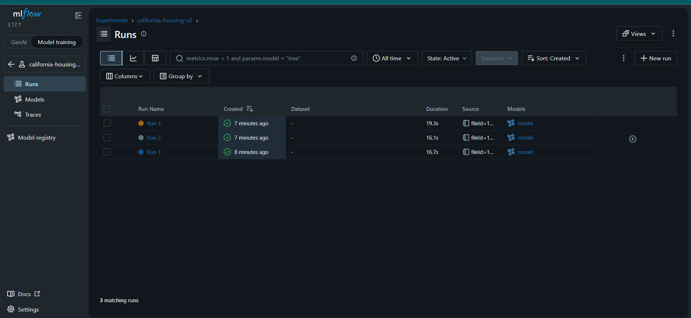

# MLflow Task: House Price Prediction

## Task Description
Track and compare 3 experiments of the same regression model (`GradientBoostingRegressor`) on the **California Housing** dataset using **MLflow**.
Each run uses different hyperparameters (`max_depth`, `learning_rate`), and MLflow logs the parameters, the validation metrics (RMSE, MAE, R²) and the trained model. The best model is selected using **RMSE**.

Data split: 80% training / 20% validation (`random_state=42`).

## How to Run
```bash
pip install -r requirements.txt
python train.py
mlflow ui --backend-store-uri sqlite:///mlflow.db
```
Then open http://localhost:5000 and select the experiment `california-housing-v2`.

## MLflow Results

### Runs list


### Runs comparison


## Comparison Table

| Run   | Max Depth | Learning Rate | RMSE  | MAE   | R²    |
|-------|-----------|---------------|-------|-------|-------|
| Run 1 | 3         | 0.1           | 0.542 | 0.372 | 0.776 |
| Run 2 | 5         | 0.05          | **0.520** | **0.353** | **0.794** |
| Run 3 | 7         | 0.01          | 0.697 | 0.531 | 0.629 |

## Selected Best Model
**Run 2** (`max_depth=5`, `learning_rate=0.05`)

## Why This Model?
RMSE is the primary selection metric, and Run 2 has the lowest RMSE (0.520). It also has the best MAE and R², so it is the best on all three metrics.

- Run 1 (depth 3) uses shallow trees, so it has less capacity to capture the data patterns.
- Run 3 (depth 7, learning rate 0.01) learns too slowly with the default number of trees, so it underfits and gives the worst results.
- Run 2 is a good balance between tree depth and learning rate.
